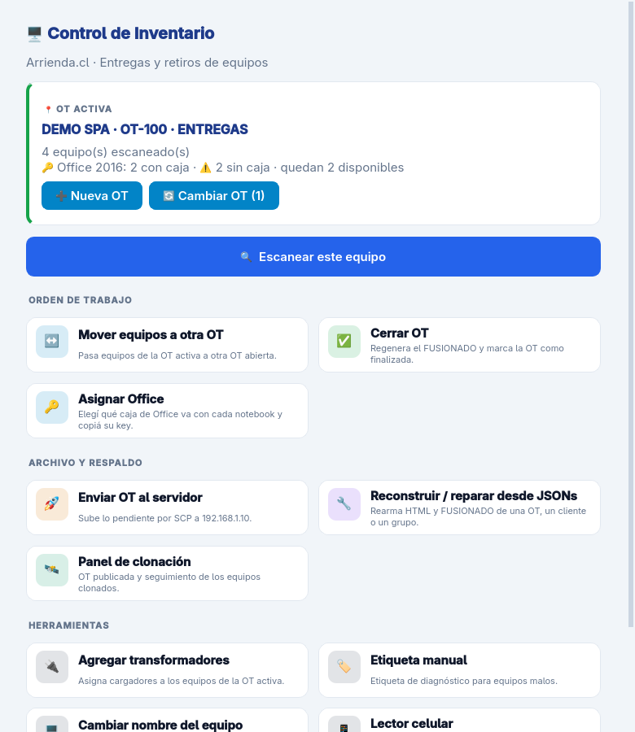
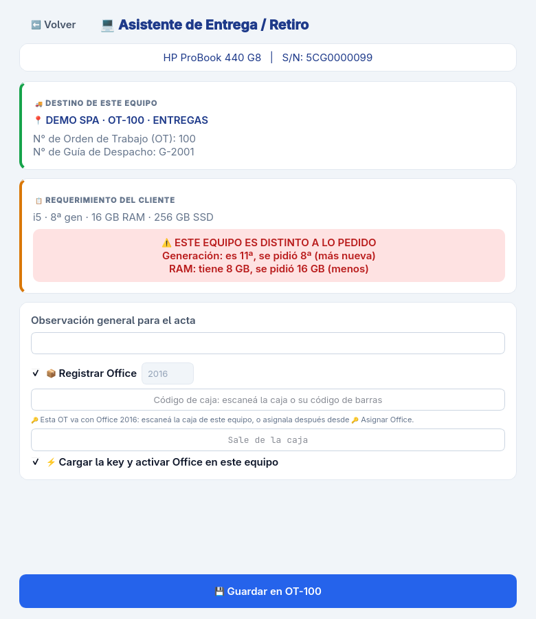
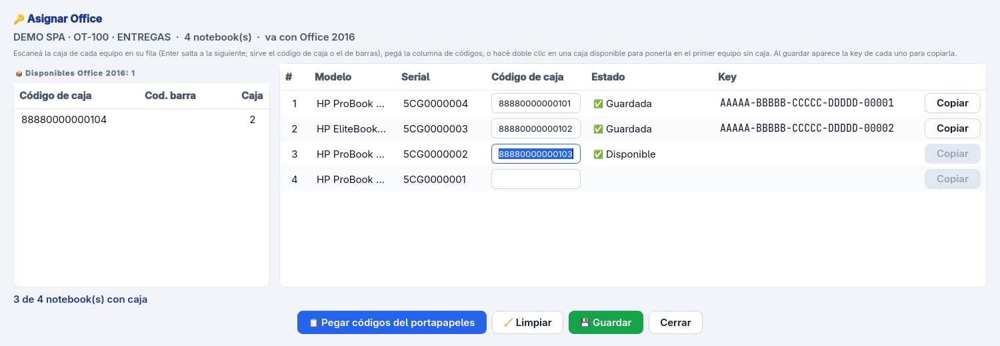

# Control de Inventario — Arrienda.cl

[](https://github.com/Tomi-Xmen/ProyectoReporte/actions/workflows/tests.yml)
[](LICENSE)


App de escritorio para el laboratorio de una empresa de arriendo de equipos:
escanea el hardware de cada notebook, lo registra en la **orden de trabajo
(OT)** de una entrega o en la **guía** de un retiro, y genera los reportes
HTML y JSON que se cargan en el sistema de la empresa. Se integra con la
clonación masiva por **FOG**, con un **lector celular** (app Android) para
escanear seriales y cargadores, y con una **base de licencias de Office**.

Interfaz en **PySide6 (Qt)**, lógica en Python puro y probada con pytest.

<p align="center">
  
  
</p>
<p align="center">
  
</p>

## Qué hace

- **Escaneo de hardware** en un clic: modelo, serial, CPU, RAM, discos,
  batería, red y licencia de Windows (PowerShell/CIM).
- **OT y guías**: cada entrega o retiro vive en su carpeta desde el primer
  escaneo; el HTML y el JSON FUSIONADO se regeneran solos en cada cambio.
- **Requerimiento del cliente**: la OT dice qué specs se pidieron y la app
  avisa si un equipo es distinto (CPU, generación, RAM, disco).
- **Clonación con FOG**: los notebooks recién clonados se escanean y envían
  su JSON por SCP; el panel central los trae y arma el reporte en vivo.
- **Lector celular**: la app Android escanea seriales y cargadores por QR /
  Data Matrix y los registra en la OT abierta del PC.
- **Licencias de Office**: base de cajas con su key, asignación caja ↔
  notebook por OT y activación en el equipo (OSPP).
- **Exportación** a la planilla de carga del sistema de la empresa (Valida).

## Requisitos

- **Windows 10/11** para escanear y activar Office (usa PowerShell). El resto
  —y todos los tests— también corre en Linux.
- **Python 3.13** o superior.
- Opcional: un servidor **SSH** para centralizar los reportes y un servidor
  **FOG** para la clonación.

## Instalación

```powershell
git clone https://github.com/Tomi-Xmen/ProyectoReporte.git
cd ProyectoReporte
python -m venv .venv
.venv\Scripts\pip install -r requirements-dev.txt
.venv\Scripts\python REPORTE3.py
```

## Configuración

Nada específico de una instalación va en el código. Todo vive en archivos
junto al programa, que **no van al repositorio** (ver [SECURITY.md](SECURITY.md)):

| Archivo | Para qué | Cómo se crea |
|---|---|---|
| `servidor.json` | Servidor SSH al que se envían los reportes | Copiar [`servidor.ejemplo.json`](servidor.ejemplo.json) y completar |
| `id_clonado` | Clave privada SSH (el nombre se fija en `servidor.json`) | Generarla y autorizarla en el servidor |
| `fog_api.json` | Tokens de la API de FOG | En `%PROGRAMDATA%\Reporte3\` o `~/.reporte3/` |
| `reglas_codigos.json` | Reglas para reconocer cada tipo de serial (opcional) | Ver `cargar_reglas` en `escaneos.py` |
| `lector_celular.json` | Emparejamiento del lector celular | Lo crea la app |
| `licencias_office.db` | Base de licencias de Office | Al importar la planilla desde la app |

Sin `servidor.json` la app funciona igual; solo el envío al servidor avisa
que falta configurarlo.

## Uso

```powershell
.venv\Scripts\python REPORTE3.py                       # menú
.venv\Scripts\python REPORTE3.py --clonacion           # modo clonación
.venv\Scripts\python REPORTE3.py --clonacion --sin-ui  # sin ventanas (post-script de FOG)
.venv\Scripts\python REPORTE3.py --verificar           # diagnóstico del envío
```

La app sigue el modo claro/oscuro de Windows.

### Lector celular

Menú → **Lector celular** → **Encender**. El panel muestra un QR que la app
del celular escanea para emparejarse; desde ahí el celular registra
notebooks, monitores e impresoras y empareja transformadores en las OT y
guías abiertas, con los mismos JSON, HTML y FUSIONADO de siempre.

- Viene **apagado**: si nadie lo enciende no se abre ningún puerto.
- Encendido, **sigue conectado aunque se cierre el panel**; se apaga con
  *Apagar* o al salir del programa. La tarjeta del menú muestra 🟢 si está on.
- *Encender solo al abrir el programa*: arranca con la app, con el mismo
  código y puerto, así el celular queda emparejado de un día para otro.
- *Código nuevo* cambia el código del QR y desempareja a todo celular.
- Si el PC no responde, el celular reintenta solo cada 5 s.
- Solo acepta conexiones de la red local. La primera vez Windows pregunta
  si permite el acceso en la red: hay que aceptar para redes privadas.
- El celular no cambia cuál es la OT activa del PC. Sí puede: elegir a qué
  equipo va cada cargador, mover o quitar equipos (lo quitado va a
  `Reportes_Guardados/_PAPELERA`), completar la guía/OT del lote y cerrarlo.

Para probarlo sin la app: en el panel, *Copiar datos de emparejamiento*, y
`.venv\Scripts\python herramientas\simular_celular.py` (cada línea es un
escaneo; sirve también una pistola USB). La app Android está en
[`android/`](android/README.md).

### Reporte en vivo

En el panel **Lector celular** → **📡 Reportes en vivo**, o en el **Panel de
clonación** → **📡 Ver en vivo**, el reporte HTML se abre en el navegador y se
recarga solo cada vez que cambia el lote. Lo sirve el programa en `127.0.0.1`
(nadie más de la red lo ve) mientras esté abierto.

### Clonación con FOG

Mientras el programa está abierto (no hace falta tener el **Panel de
clonación** abierto), cada 15 s se trae del servidor lo que mandaron los
equipos clonados a la OT publicada y se regeneran su HTML y su FUSIONADO. La
tarjeta de la OT en el menú muestra cuántos llegaron, cuántos esperados
faltan y si se perdió la conexión; sin OT publicada consulta cada minuto. Solo baja lo nuevo o lo que cambió: lo cargado en esta PC (un
cargador, una corrección) no se pisa, y lo quitado a mano no vuelve salvo que
el equipo mande un escaneo nuevo. **Traer y reconstruir** hace lo mismo a
pedido y además rearma el reporte aunque no haya nada nuevo.

**Cerrar OT**, desde el menú o desde el panel, es un solo cierre: si la OT
está publicada para clonación, primero la cierra en el servidor (desde ahí
ningún equipo puede enviar), trae todo lo que llegó y recién después la
cierra en la PC, así el FUSIONADO tiene todos los equipos aunque el panel
haya estado cerrado. Si faltan equipos esperados, lo avisa antes. El celular
no puede cerrar una OT publicada: indica cerrarla desde el PC.

El post-script de FOG ([`fog_postscript.sh`](fog_postscript.sh)) copia a cada
equipo el programa, la clave SSH, `servidor.json` y el lanzador
[`fog_postscript.bat`](fog_postscript.bat), que registra el equipo en su
primer arranque.

### Buscar serie

Menú → **🔎 Buscar serie**. Se escanea o escribe la serie (con 4 caracteres o
más busca también una parte, para etiquetas gastadas) y muestra cada OT o
guía en que estuvo el equipo, abiertas, cerradas y lo quitado: fecha,
entrega o retiro, cliente, estado, fallas, cargador y Office, más las cajas
de Office que tuvo según la base de licencias. **Generar HTML** arma su
reporte con las filas marcadas, con la misma plantilla de las OT (copiar a
Valida, CSV y etiquetas funcionan igual), y lo guarda en
`Reportes_Guardados/_CONSULTAS/`.

### Licencias de Office

Menú → **🔑 Licencias de Office**. La base es la fuente de verdad de qué caja
tiene cada equipo.

- **Importar** la planilla de cajas (`.xlsx` o `.csv`) con su estado
  (disponible, asignada, deshabilitada); lo que recordaba de cada caja queda
  en su historial. Importar de nuevo solo agrega cajas nuevas.
- **OT con Office**: al crear la OT de entrega se elige la versión; *📦 Ver
  cajas* muestra las disponibles y en qué caja de almacenamiento están.
- **🔑 Asignar Office**: se elige qué caja va con cada notebook (pistola,
  pegar desde Excel o doble clic). Guardar asigna todo junto o nada, escribe
  el número de caja en cada JSON y regenera el reporte (al reporte, a Valida y
  al FUSIONADO va el número de caja, nunca la key). Después cada fila muestra su key
  con un botón **Copiar** para activar Office en el equipo.
- En el formulario se puede escanear la caja del equipo; en 2013/2016 la app
  carga la key y activa Office (pide permiso de administrador una vez).
- **Retirar** un equipo, o quitarlo de la OT, libera su caja.
- **Exportar** deja toda la base en un CSV para Excel.

## Compilar el .exe

```powershell
.venv\Scripts\pyinstaller REPORTE3.spec
```

Sale en `dist/REPORTE3/`. Para los equipos clonados, esa carpeta va al
servidor de FOG junto con `id_clonado`, `servidor.json` y `fog_postscript.bat`.

## Arquitectura

```
REPORTE3.py              lanzador (el .exe se compila desde acá)
inventario/
  app.py                 elige el modo: menú, --clonacion, --verificar
  nucleo/                lógica sin interfaz (se prueba sin ventanas)
    config.py            carpeta base, servidor (servidor.json), librerías opcionales
    escaner.py           script de PowerShell y lectura del hardware
    lotes.py             OT/guías en disco: guardar, cerrar, mover, backups
    requerimiento.py     specs pedidas en una entrega y aviso si un equipo difiere
    licencias_office.py  base de cajas de Office: importar, asignar, liberar
    activacion_office.py carga la key en el equipo y activa (OSPP)
    office_ot.py         OT con Office: qué caja va con cada notebook
    historial.py         buscador de series: historial de un equipo y su HTML
    escaneos.py          lector celular: elegir el serial y aplicarlo al lote
    gestion_lote.py      lector celular: cargadores, mover/quitar, guía/OT, cierre
    api_celular.py       lector celular: qué responde el PC a cada pedido
    reporte_vivo.py      reporte HTML servido con recarga automática
    sincronizacion.py    traer automático de la OT de clonación
    reporte_html.py      plantilla del reporte y entrada de cada equipo
    reconstruccion.py    rearmar HTML y FUSIONADO desde los JSON
    remoto.py            envío por SCP y control central de clonación
    fog.py               API de FOG (multicast)
    transformadores.py   carga masiva de transformadores
    etiquetas.py         etiqueta manual de diagnóstico
    clonacion.py         modo clonación y diagnóstico (--verificar)
  ui/                    interfaz Qt
    tema.py              colores (claro/oscuro) y hoja de estilos
    widgets.py           piezas reutilizables (tarjetas, tablas, botones)
    tareas.py            trabajo en segundo plano sin congelar la ventana
    servidor_celular.py  HTTP del lector celular (QtNetwork)
    reporte_vivo.py      HTTP del reporte en vivo (solo 127.0.0.1)
    modulos/             pantallas: mover OT, transformadores, etiquetas,
                         clonación, lector celular, licencias, asignar Office
tests/                   pruebas (pytest)
herramientas/            simular_celular.py: prueba el lector sin la app
android/                 app Android del lector celular (Kotlin)
```

La regla de la estructura: **`nucleo/` nunca importa nada de `ui/`**. Toda
pantalla nueva llama al núcleo; toda regla de negocio nueva va en el núcleo
con su test.

## Desarrollo

```powershell
.venv\Scripts\python -m pytest          # tests de Python (en Linux: QT_QPA_PLATFORM=offscreen)
cd android; .\gradlew testDebugUnitTest # tests de la app Android
```

Cada push y pull request corre los dos en
[GitHub Actions](.github/workflows/tests.yml).

## Seguridad

Ver [SECURITY.md](SECURITY.md): cómo reportar una vulnerabilidad y qué
archivos nunca van al repositorio.

## Licencia

[MIT](LICENSE) © 2026 Tomi-Xmen
